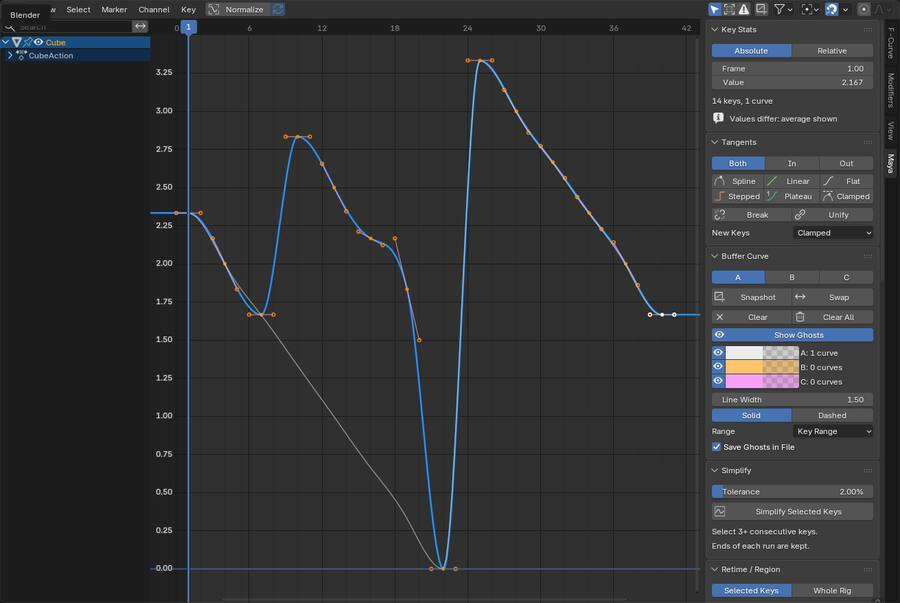
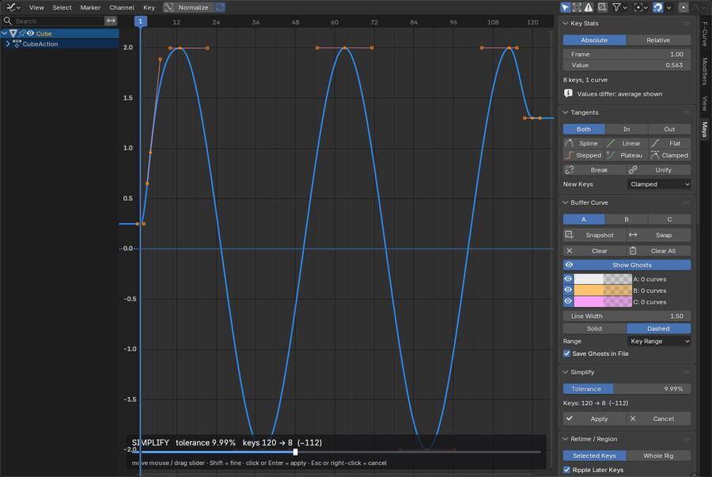
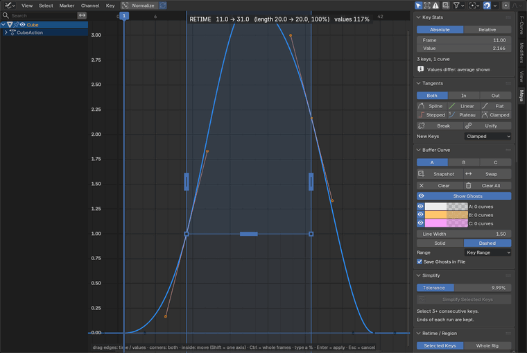
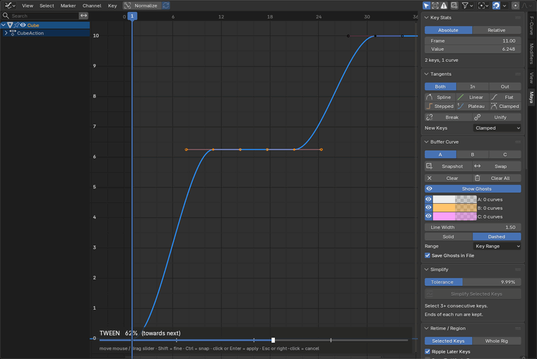
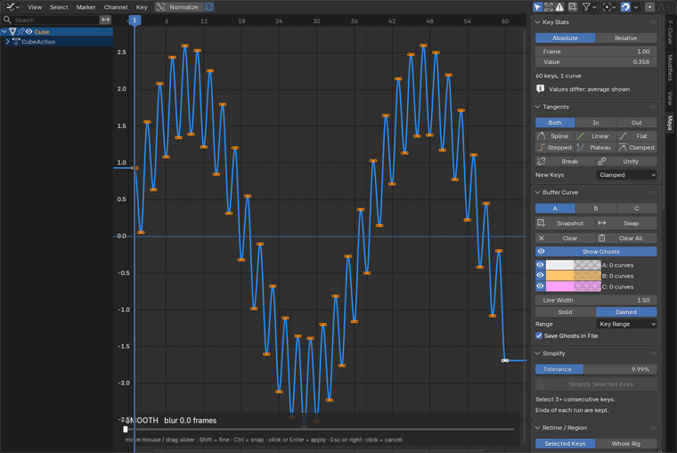
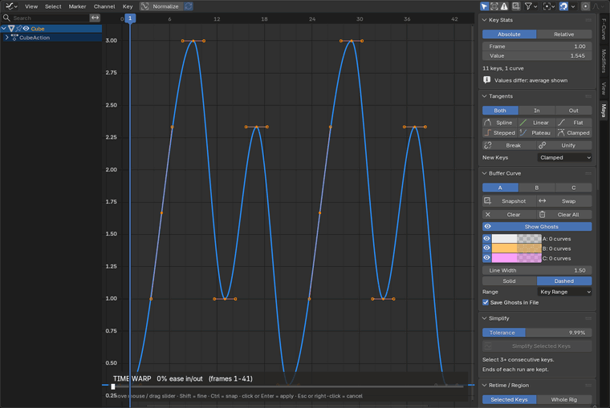
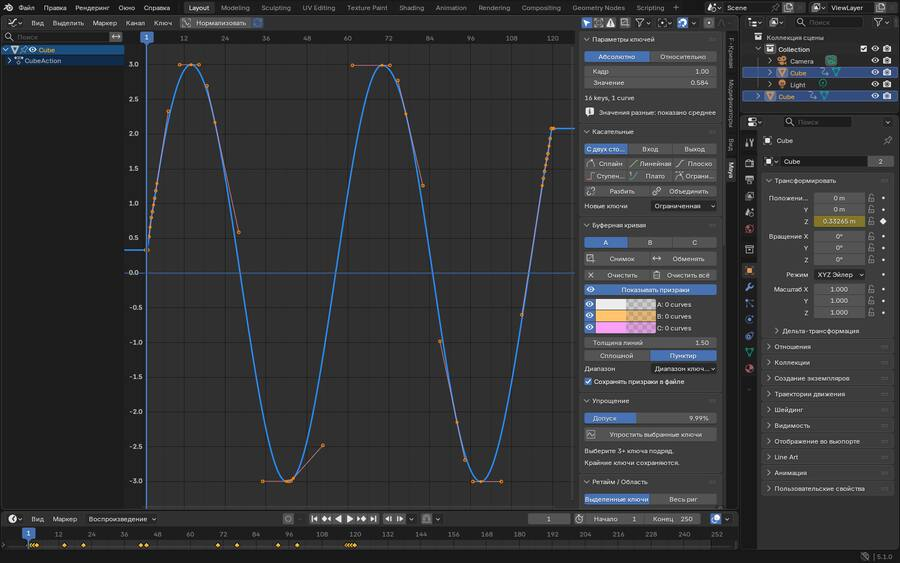

# Maya Graph Editor Tools for Blender

Maya-style comforts for Blender's **Graph Editor**, in one add-on. Everything lives in the Graph Editor
sidebar (**N → Maya** tab). No new windows, no node graph, nothing that touches rendering or export.



| Tool | What it does |
|---|---|
| **Key Stats** | Frame and value fields for the whole selection, absolute or relative (Maya's stats boxes). |
| **Tangents** | Spline · Linear · Flat · Stepped · Plateau · Clamped, one click each, for both sides, In only or Out only. Break / Unify. Default tangent for new keys. Pie menu. |
| **Buffer / Ghost Curve** | Snapshot curves into slots A/B/C and see them as faint overlays while you edit. Swap like Maya's buffer curve. Saved in the .blend. |
| **Simplify (live preview)** | Move the mouse or drag a slider to see the curve lose keys in real time. Confirm or cancel. |
| **Retime / Region** | A lattice around the selected keys: edges stretch time or scale values, corners do both, inside moves. Presets, exact length, fit to range, whole-rig retiming. |
| **Tween** | Maya Tween Machine: slide selected keys between their neighbours, with overshoot; key at the playhead. |
| **Smooth (live preview)** | Remove jitter with a blur slider; steady motion stays straight. |
| **Time Warp** | Ease the timing inside a range (slow in / slow out) without touching values. |
| **Mocap Cleanup** | Bake, simplify and set tangents in one click. |
| **Curves** | One-click Pre/Post Infinity (Constant, Linear, Cycle, Cycle with Offset, Oscillate) and Euler filter. |
| **Blocking** | Stepped Preview for blocking review, Round to Whole Frames, Seamless Loop, Equalize Handles. |
| **Stagger / Overlap** | Offset bones or curves in time for overlap, or generate follow-through down a chain. |
| **Key Sliders** | Blender's own slider tools (Breakdown, Ease, Push/Pull, Shear and more), one click away. |
| **Channels & Selection** | Saved channel sets, Isolate, selection helpers. |
| **Noise / Settle** | Add smooth noise, or a decaying wobble after a move. |
| **Shapes & Paste** | A library of curve shapes, and copy/paste with Merge, Replace, Insert and Fit. |
| **Stacked Overview** | Experimental read-only view with one lane per curve. |

Each tool can be switched off independently (**Preferences → Add-ons → Maya Graph Editor Tools**, or the
collapsed *Enabled Tools* panel at the bottom of the Maya tab). A switched-off tool's panel is hidden and its
operators, shortcuts and overlays do nothing. All tools are registered once when the add-on is enabled, and the
add-on runs no background timers.

## Install

Requires **Blender 4.2 or newer** (tested in CI on 4.2 LTS and 5.1).

```bash
python3 build.py     # writes dist/maya_graph_editor-1.3.1.zip (+ a -legacy.zip)
```

* **Blender 4.2+:** Preferences → Get Extensions → ⌄ menu → *Install from Disk…* → pick
  `maya_graph_editor-1.3.1.zip`.
* Legacy add-on install (Preferences → Add-ons → Install from Disk) → use the `-legacy.zip`.

## Shortcuts (Graph Editor)

| Shortcut | Action |
|---|---|
| **Alt+V** | Tangent pie menu |
| **Ctrl+Alt+B** | Ghost: snapshot into the active slot |
| **Ctrl+Alt+Shift+B** | Ghost: swap with the active slot |
| **Ctrl+Alt+X** | Simplify selected keys |
| **Ctrl+Alt+T** | Retime / Region lattice |

They are listed and rebindable in the add-on preferences. The GUI test checks that none of them clashes with
Blender's default Graph Editor keymap.

## Using the tools

### Key Stats
* **Absolute:** *Frame* shows the first selected frame; typing a frame moves the whole selection there (spacing
  kept). *Value* shows the shared value (the average if they differ); typing sets every selected key to it.
* **Relative:** both fields start at 0 for a new selection; typing or dragging offsets every selected key.
* Rotation is shown in degrees when every selected key is on a rotation curve. Handles move with their keys.

### Tangents (applied to selected keyframes)

| Button | Blender equivalent |
|---|---|
| Spline | Automatic handles, Bezier (can overshoot, like Maya spline) |
| Clamped | Auto-clamped handles, Bezier (no overshoot) |
| Linear | Linear interpolation |
| Flat | Horizontal handles, Bezier |
| Stepped | Constant interpolation |
| Plateau | Flat handles at local extremes and end keys, automatic elsewhere |

* **Both / In / Out** above the buttons chooses which tangent changes. **Ctrl+click** a button = In only,
  **Alt+click** = Out only. In Blender, interpolation belongs to the segment *leaving* a key, so *In* Linear or
  Stepped changes the previous key's segment, which is the one entering the selected key. One-sided changes
  break the handles so the other side keeps its shape.
* **Break** frees the in/out handles; **Unify** lines them up again (average direction, each keeps its length).
* **New Keys** sets Blender's own preference for newly inserted keys (Spline, Clamped, Linear, Stepped).
* Optional: the six buttons as icons in the Graph Editor header (add-on preferences).

### Buffer / Ghost Curve
* Pick slot **A, B or C**, then **Snapshot** (selected curves, or all visible ones if none is selected).
  Each slot has its own colour and eye toggle, so you can compare up to three versions at once.
* Ghosts are only drawn on top of the Graph Editor: they can't be selected or get in the way of editing.
* **Swap** (Maya's "swap buffer curve"): the curve takes the slot's shape and its current shape goes into the slot.
* **Clear** empties the active slot, **Clear All** every slot.
* **Range:** the curve's key range, or the scene/preview frame range (shows cycles and extrapolation).
* **Solid** or **Dashed** lines, adjustable width.
* **Swap Range** swaps only the time range of the selected keys with the ghost.
* **Ghost from Action**: pick another action (a reference, mocap, an earlier take) and its matching channels
  appear as ghosts.
* **Colour Palette** offers a colour-blind-safe set (yellow, purple, white).
* **Save Ghosts in File** (on by default) keeps them in the .blend, stored on each action when you save.

### Simplify (live preview)



1. Select a run of **3+ consecutive keys** (on one or several curves) and press **Simplify Selected Keys**.
2. **Move the mouse** (Shift = fine) or drag the **Tolerance** slider in the sidebar. The real curves are
   rebuilt live, so what you see is exactly what you'll get. A bar at the bottom shows tolerance and
   `keys before → after`.
3. **Click / Enter / Apply** keeps the result (one undo step). **Esc / right-click / Cancel** restores the
   curves exactly as they were.

The first and last key of each selected run are always kept. Tolerance is a percentage of each curve's value
range over the selection, so one slider suits location, rotation and scale at once. Big selections (300+ keys)
are analysed in the background with a progress bar; Esc during analysis changes nothing.

### Retime / Region



1. Select keys on one or more curves, press **Retime / Region** (Ctrl+Alt+T).
2. A box surrounds the selection:
   * **left / right edge**: stretch or compress in time about the opposite edge (handle lengths follow, so
     shape is kept). Type a percentage (e.g. `5` `0`) + Enter to scale time exactly.
   * **top / bottom edge**: scale the values about the opposite edge. Works in what you see, so rotation
     in degrees and normalised views behave as expected.
   * **corners**: both at once. **Inside**: move the block (**Ctrl** = whole frames, **Shift** = one axis).
3. **Enter / Apply** keeps it, **Esc / Cancel** puts everything back. Drag as often as you like before confirming.

Without the lattice, the panel offers **×0.5 / ×2**, a **Scale %** with an anchor (Start, Center, End or
**Playhead**), an exact **Length**, **Fit Preview Range** and **Fit Markers** (between two selected markers),
plus **Value Scale %** about Zero, First Key, Last Key or Center.

* **Scope: Whole Rig** retimes every key of the selected objects (selected bones in Pose Mode) inside the
  selection's time range, including channels that aren't shown. Time only.
* **Ripple Later Keys** (default on) moves keys beyond the edge along with it, so nothing collides.

### Tween



Selected keys move to an in-between of the unselected keys on either side: **0%** = previous key,
**100%** = next key, below 0 or above 100 overshoots. Drag the mouse or the slider (Ctrl snaps to 25%),
or click a preset (0 / 25 / 50 / 75 / 100). **Key at Playhead** keys the selected curves at the current frame
at that in-between.

### Smooth



Drag to set the blur width in frames and watch the jitter go. It fits a small weighted line through
neighbouring keys rather than averaging them, so steady motion and ramps stay straight. The first and last
key of each selected run stay put.

### Time Warp



Choose **Ease In**, **Ease Out** or **In/Out** and drag the amount: keys inside the selected time range are
re-spaced along the easing curve. Values never change and the range ends stay put.

### Mocap Cleanup

One button, one undo step: **bake** the selected range to a key per frame (modifiers are muted while sampling, so
a Noise modifier isn't baked in twice), **simplify** to the tolerance, then set **tangents** (Clamped by default).

### Curves
* **Pre / Post Infinity** rows set how each end of the selected curves continues; the active curve's current mode
  is highlighted. Cycle modes use a Cycles modifier. Blender has one Constant/Linear setting for both ends, so
  choosing Constant or Linear for one end also changes a non-cycling other end (the add-on tells you).
* **Euler Filter** runs Blender's discontinuity filter on the selected rotation curves.

### Blocking
* **Stepped Preview** shows the selected objects' animation stepped, for blocking review. It sets every key
  to Constant and remembers what each key had (on the action, so it survives saving). Click again and the
  splines are back. Keys added while it is on get Blender's default interpolation afterwards.
* **Round to Whole Frames** moves the selected keys to the nearest frame. **Auto** does it after Retime / Region,
  Time Warp and Stagger, so stretching never leaves keys between frames.
* **Seamless Loop** makes the last key match the first and turns on Cycle, so a cycle loops without a pop.
* **Equalize Handles** resets handle lengths to a third of the neighbouring segment, keeping their angle
  (Maya's non-weighted tangents).

### Stagger / Overlap
Choose how curves are grouped (**Per Bone / Object** or **Each Curve**) and ordered (**Channel List Order** or
**Bone Hierarchy**, root to tip; the arrow reverses it).
* **Stagger**: drag to shift each group's selected keys a little later than the group before it.
  *Gain per Step* also scales each step's values, e.g. 85% for motion that dies down along a tail.
* **Overlap**: the first group is the leader. Every later group gets a delayed, scaled copy of the leader's
  matching channels, starting from its own first key's value. It replaces the followers' keys in that range.

### Key Sliders
Blender's built-in interactive sliders (Breakdown, Blend to Neighbor, Ease, Push / Pull, Shear, Match Slope,
Gaussian and Butterworth Smooth, and others), normally three menus deep. They work on the selected keys of
**selected channels**, and are Blender's own tools: click to apply, right-click to cancel.

### Channels & Selection
* **Channel Sets**: select channels, press **+**, name the set. Clicking a set shows only those channels on the
  selected objects. Sets store property names, so one set works on every character with the same rig.
* **Isolate** shows only the selected curves; click again to restore. **Show All** unhides everything.
* **Select Keys**: at the playhead, in the preview range, every Nth, or invert per curve.

### Noise / Settle
* **Noise**: drag to add smooth random variation to the selected keys. *Scale* is frames per wiggle; the same
  *Seed* always gives the same result.
* **Settle**: select the key where a move ends and drag: a decaying wobble is added after it, sized by how fast
  the curve was moving. *Wobble* is frames per swing, *Length* how long until it rests.

### Shapes & Paste
* **Shape Library**: select the keys of a move you like and **+** to save its shape. **Apply Shape** stretches a
  shape between the first and last selected key of every curve. Four shapes are built in (Ease In-Out, Overshoot,
  Anticipation, Bounce Settle); yours are stored in Blender's user folder and available in every file.
* **Copy Keys**, then paste at the playhead: **Merge** keeps existing keys, **Replace** clears the pasted range
  first, **Insert** pushes later keys back, **Fit** stretches the copy over the selected keys' range.
  *Relative Values* starts the pasted keys from the curve's current value.

### Stacked Overview (experimental)
One lane per shown curve, scaled to fit, keys marked, on the editor's own time axis. It is read-only: Blender
doesn't let add-ons change how the Graph Editor draws or edits curves (see `docs/research_stacked_view.md`),
so turn it off to edit.

## Updating from GitHub

**Preferences → Add-ons (or Extensions) → Maya Graph Editor Tools → Updates**:

* **Check for Updates** asks GitHub for the latest release of this repository and compares its version with
  the installed one. The version comes from the zip's name (`maya_graph_editor-1.3.1.zip`), or from the tag
  (`v1.3.1`) if the zip name has none.
* **Install x.y.z** downloads the right zip (Extension or legacy), checks its SHA-256 when GitHub provides one,
  and installs it with Blender's own installer. **Release Notes** opens the release page.
* Needs Blender's **Allow Online Access** (Preferences → System → Network). Nothing is downloaded otherwise.

### extensions.blender.org
Blender's extension platform updates add-ons itself and doesn't allow them to update themselves.
`python build.py --store` writes `dist/store/maya_graph_editor-<version>-extensions.zip`: the same add-on with
no updater and no network permission. That is the file to submit there. (A normal build installed from a
remote repository also switches its updater off.) Listing text is in `docs/extensions_listing.md`.

### Publishing a release (maintainer)
1. Bump the version in **both** `maya_graph_editor/blender_manifest.toml` and `bl_info` in `__init__.py`
   (`build.py` refuses to build if they differ).
2. Commit, then tag and push: `git tag v1.3.1 && git push origin v1.3.1`. Use the add-on's version as the tag,
   because add-on versions up to 1.1.0 read the version from the tag only.
3. The **Release** GitHub Action builds both zips and publishes the release. That's what the updater installs.

## Language, colours and settings



* The interface is translated into **Russian, Spanish, French, German, Japanese, Simplified Chinese and
  Brazilian Portuguese** (Preferences → Interface → Translation). The table is in
  `maya_graph_editor/i18n_data.py`; corrections from native speakers are welcome.
* On-screen bars and the lattice use your **theme's colours**, and **On-Screen Text Size** makes them larger.
* **Export / Import Settings** moves tool options, enabled tools, shortcuts and channel sets between machines.
* After an update, a **What's New** note appears in the Maya tab and the preferences (can be turned off).

## Tests

Every push runs **Tests** on GitHub Actions:

* **Headless** (`pip install bpy`): data logic of every tool against real F-Curves.
  ```bash
  python tests/test_addon.py            # registration/toggles, snapshots, tangents, ghost, retime, simplify
  python tests/test_v11.py              # v1.1 features: sides, break/unify, infinity, stats, slots, saving
  python tests/test_v12.py              # v1.2: tween, smooth, warp, cleanup, region, rig scope, translations
  python tests/test_v13.py              # v1.3: blocking, stagger/overlap, channels, generators, shapes, paste
  python tests/test_simplify_model.py   # simplify error model vs. Blender's real curve evaluation
  python tests/test_updater.py          # updater: versions, asset choice, checksum, Blender installer
  ```
* **GUI** in real Blender **4.2 LTS and 5.1** under Xvfb (`tests/gui/run_gui_tests.py`), driven by simulated
  mouse and keyboard events. It exercises the interactive tools, checks shortcut conflicts, and fails on any
  Python traceback. It also asks Blender where it draws keys and compares that with the add-on's own mapping,
  for plain curves, rotation in degrees, Normalize, the seconds display and NLA strips in tweak mode.
  It runs Blender's extension validator and records the screenshots and GIFs used here.
* A weekly run against **Blender's daily build** gives early warning of API changes (allowed to fail).

## Limitations

* Ghosts are matched to curves by (action, data path, array index); renaming an action loses its ghosts.
* The region lattice and Stacked Overview assume the same time mapping for all curves; with several NLA
  strips in tweak mode at different offsets only ghosts are mapped per curve.
* Stacked Overview is read-only, and Blender's own value-axis numbers still show on top of it.
* Only Tangents work in the Drivers editor.
* The translations have not been reviewed by native speakers.

## Layout

```
maya_graph_editor/
  __init__.py  core.py          registration, preferences, per-tool toggles, settings
  common.py                     curve snapshots, display mapping, drawing, theme colours
  slider.py                     shared live-preview slider (tween, smooth, warp, stagger, generate)
  ghost.py tangents.py simplify.py retime.py curves.py stats.py cleanup.py
  blocking.py stagger.py hub.py channels.py generate.py shapes.py stacked.py
  keymaps.py  i18n.py  i18n_data.py  presets.py  whatsnew.py  updater.py
  simplify_core.py              removal-order maths (numpy only)
  blender_manifest.toml
store/updater.py                stand-in used by `python build.py --store` (extensions.blender.org build)
tests/  tests/gui/  docs/  build.py  .github/workflows/
```
